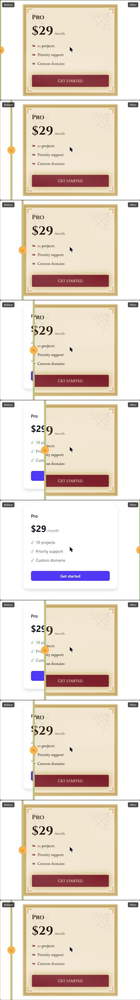

# Possessed

> Paste one UI component. A ghost designer possesses it.

Possessed returns spooky-themed code for your component and shows a live before/after preview. Chat with Vesper, the ghost designer, to refine it ("less scary", "keep my brand colours"). Hand it a whole page and it refuses in character: *"This is beyond my ghostly powers."*

Built for the DEV Hacktoberfest Week 4 challenge, **"Ghost in the Machine"**. Powered by Gemma 4 (open weights).


<!-- TODO(T2.7): live link -->

## How it works

```
paste code -> size gate -> Gemma 4 -> streaming parser -> validation (retry once) -> sandboxed preview
```

1. **Size gate** (`src/lib/limits`): one component only, at most 200 lines and 8,000 characters. Whole pages and non-UI input are refused in character before any model call, so they cost no tokens.
2. **Gemma 4** (`src/lib/model`): called through the Gemini API by default (`gemma-4-31b-it`, falling back to `gemma-4-26b-a4b-it`). An OpenAI-compatible provider lets you point at Gemma on your own GPU Droplet instead.
3. **A hand-made effects library** (`src/effects`): 15 pure-CSS `ghost-*` effects and 5 presets (Haunted Victorian, Día de los Muertos, Possessed Terminal, Gothic Cathedral, Jinn's Palace). The model chooses effects by class name and adjusts colours, fonts and spacing; it does not invent large CSS blobs, and unknown classes are stripped.
4. **Validation**: the output is checked against the original (same component, props and text meaning). A failed check is retried once.
5. **Preview**: the result renders next to the original in a sandboxed iframe, with a contrast check afterwards.

## Safety

Pasted and generated code is never trusted. It only runs inside an `<iframe srcdoc>` with `sandbox="allow-scripts"` (never `allow-same-origin`), a strict Content-Security-Policy and no network access. The app never evaluates user code in its own origin. React and the Tailwind browser build are self-hosted in `public/vendor/`. The Gemini API key stays on the server, and requests are rate-limited per IP (20 per hour by default).

## Accessibility

Effects respect `prefers-reduced-motion`. After each possession the preview checks text against WCAG AA and offers a one-click "Fix contrast".

## Numbers

From the eval (`npm run eval`: 5 sample components x 5 presets, `gemma-4-26b-a4b-it`): 23 of 25 possessions passed validation without a retry (92%), average latency 21.8 s. Details in `tasks/notes.md`.

## Limits

- One component at a time. Big components must be split.
- Imports in pasted code cannot cross into the preview; they show as dashed placeholders.
- Gradients and images behind text cannot be contrast-checked.
- With the default setup, pasted code is sent to the Gemini API. Run Gemma yourself (`MODEL_PROVIDER=openai-compat`) if that is not acceptable.
- Latency depends on the model: about 20 s typical, and much slower when the 31B model is busy and the app falls back.

## Development

```bash
npm install
cp .env.example .env.local   # add GEMINI_API_KEY
npm run dev
npm test
npm run eval                 # possess every fixture in every preset
```

This repo is built spec-first:

| Folder | What's in it |
|---|---|
| `specs/` | Source of truth: requirements, architecture, size gate, effects and presets, preview sandbox, ghost engine, model, deployment, testing |
| `tasks/` | Day-by-day checklists with acceptance criteria, plus a backlog |
| `decisions/` | Architecture decision records |
| `src/` | Next.js 16 (App Router), TypeScript strict, Tailwind v4, Zod at every boundary |

Deployment target: DigitalOcean App Platform (`.do/app.yaml`).

## License

Apache 2.0. React 18 UMD files in `public/vendor/` are MIT-licensed (see `public/vendor/REACT-LICENSE.txt`).
