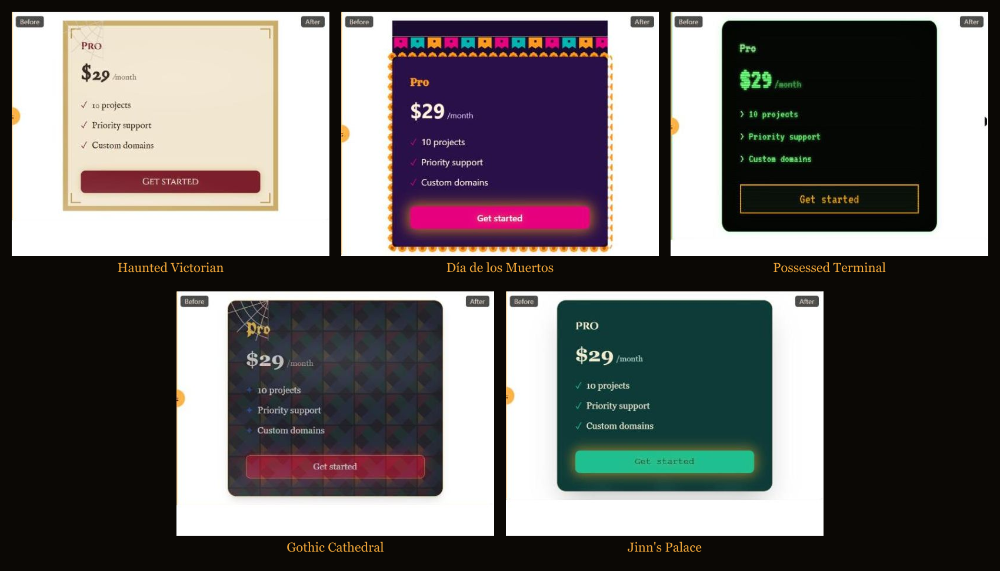
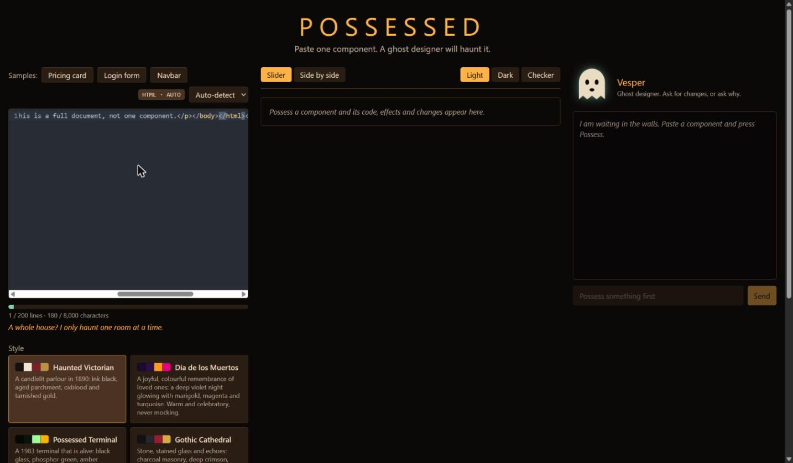
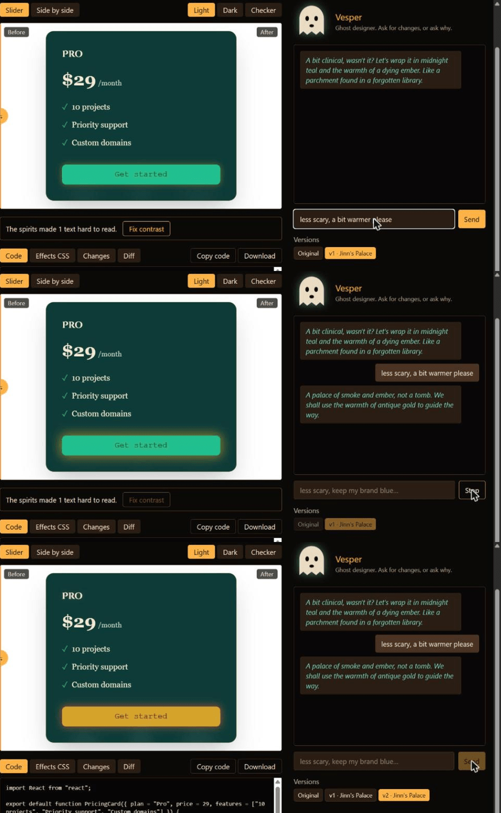

<!--
DRAFT 1. Open items before publishing (spec 10 §10.4):
  - [x] hero GIF, presets grid, chat GIF, refusal screenshot, cover (docs/assets). Images use relative paths: upload them to DEV and swap the links when publishing. Still missing: the 60-90 s video.
  - [ ] live link (T2.7, deploy not done yet)
  - [x] tokens per possession measured (see the table). It is one component (the pricing card), 5 runs: re-measure on the final build if you can.
  - [ ] live-site latency: eval numbers below are from the eval run, not the deployed site
  - [ ] the hook below follows spec 10 ("agency"); rewrite it if that is not your real story
  - [ ] DEV AI-disclosure setting on the post
  - [ ] check the "What the eval could not catch" section still reads true after any later fixes (it describes the clipped-frame bug and the duplicate `style` attribute; the second is NOT fixed, see tasks/backlog.md)
-->

*This is a submission for the Hacktoberfest Week 4 Challenge: Ghost in the Machine (TODO: use the exact challenge template line and link from the challenge page).*

Every October someone asks for a spooky version of a website, and it eats a week.
So I hired a ghost.


## What I Built

Possessed is a website where you paste the code of **one UI component** and a ghost designer called Vesper possesses it. You get back spooky-themed code for the same component and a live before/after preview, and you can keep talking to the ghost: "less scary", "more Día de los Muertos", "keep my brand colours".

There are five presets: Haunted Victorian, Día de los Muertos, Possessed Terminal, Gothic Cathedral and Jinn's Palace.



The component stays the same component. Same name, props, structure and meaning of the text; only the styling changes (unless you switch on "possess the words too").

Hand it a whole page and it says *"This is beyond my ghostly powers."* That refusal is part of the personality, and it is also cost control: oversized or non-UI input is turned away before any model call, so it costs nothing.



## Demo

- Live site: **TODO live link**
- Video: **TODO unlisted YouTube link**

Try the three sample buttons (pricing card, login form, navbar), or paste one of your own.

## Code



## How I Built It

```
paste code -> size gate -> Gemma 4 -> streaming parser -> validation (retry once) -> sandboxed preview
```

**The size gate comes first.** One component, at most 200 lines and 8,000 characters. Small components re-theme reliably on an open model; whole pages come back truncated and lose their structure. So the app says no early, in character.

**A hand-made effects library, so a small model chooses instead of inventing.** I wrote 15 pure-CSS `ghost-*` effects (fog, cobwebs, candle flicker, papel picado, CRT scanlines and so on) and five presets that pick a palette, fonts and effects per intensity. Gemma applies effects by class name and adjusts colours, fonts and spacing. Anything it invents that isn't in the library is stripped in validation. This keeps the output polished and small, and it is what makes the results consistent enough to demo.

**Untrusted code runs in a box.** Pasted code and generated code both go into an `<iframe srcdoc>` with `sandbox="allow-scripts"` (never `allow-same-origin`), a strict CSP and no network. The app never evaluates user code in its own origin. React and Tailwind are self-hosted so the CSP can stay tight. I wrote attacks against my own preview (touching the parent DOM, `fetch`, an infinite loop, `<script src>`) and a watchdog removes a frame that never reports ready.

**Numbers.** I ran every sample component through every preset (25 possessions on `gemma-4-26b-a4b-it`):

| | |
|---|---|
| Passed validation without a retry | 23 of 25 (92%) |
| Passed after one retry | 1 |
| Failed | 1 |
| Average latency per possession | 21.8 s (full eval); 16 to 56 s, average 40 s, in a later 5-run check on the same day |
| Tokens per possession (pricing card, one call) | about 1,100 in, 600 to 800 out |
| A retry | roughly doubles the prompt tokens (1,962 in for the one retried run) |

*(These are eval numbers from my machine, not measurements of the deployed site.)*



**What the eval could not catch.** Validation checks the code, not the picture. My eval said 92% while the live preview could still show "The spirit froze". The cause turned up while I was capturing screenshots: if the slider was dragged to the far right, the possessed frame was clipped away completely, and browsers do not run `requestAnimationFrame` in a frame nobody can see. The frame waited on an animation frame to say "ready", never got one, and my five-second watchdog correctly declared it frozen. The fix was one line (also report ready from a timer) and a regression test, and it is a good example of why the watchdog existed in the first place.

The model has quirks too. In one generated pricing card it put two `style` attributes on the same element. JSX accepts that and the last one wins, so a heading silently lost its font. My validator did not flag it. That is on the list of things I would fix next.

**Readability.** After each possession the preview checks text against WCAG AA and, if the spirits made something hard to read, offers a "Fix contrast" button that asks Vesper to repair exactly those texts.

## Why Does Open Innovation Matter?

- **Agency code is client code.** With an open model you can run it on infrastructure you control. Possessed has a second provider that speaks the OpenAI-compatible API, so pointing it at Gemma on a DigitalOcean GPU Droplet is a config change rather than a rewrite. By default it calls Gemma through the Gemini API, and the site says so plainly: pasted code goes to that API.
- **Predictable cost and no deprecation surprise** in the middle of a campaign, because the weights don't get switched off.
- **You can see and change how the ghost is prompted and constrained.** The prompt, the effects library and the validation rules are all in the repo.
- **Honest trade-offs.** One of my 25 eval runs failed outright, the model sometimes needs a retry, and the 31B model was slow enough on day two that the app fell back to the 26B one. My first live possession took 111 seconds; later ones took about 48, and on release day a five-run check averaged 40 s. The size gate exists because small components are where an open model is dependable, not because I tested the big ones and gave up on them.

## The Spirit of It

The Día de los Muertos preset is not a skull filter. It is a celebration of remembrance, so its guidance tells the ghost to use marigolds and papel picado and to avoid horror, mockery or gore. A test fails if that guidance goes missing.

## Prize Categories

- **DigitalOcean**: TODO, depends on the deploy
- **Gemma**: Gemma 4 is the engine for every possession

## Bring me one component at a time

Paste a component. Vesper will do the rest.
